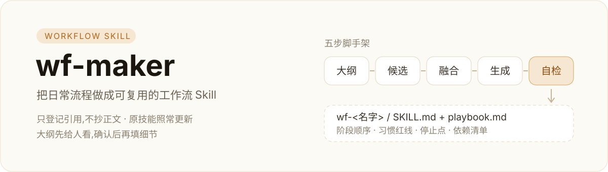

# wf-maker



把日常反复要走的流程,做成一个 `wf-` 开头的工作流 Skill,并负责它之后的更新与体检。

适合「同一件事每周都要走一遍、每次都要重新想一遍」的情况。它不替你做事,只负责把**流程、依赖、边界**组织清楚。

## 它会做什么

| 你说 | 它走 |
| --- | --- |
| 「帮我创建成一个工作流 skill」 | 脚手架五步:出大纲 → 停下等你确认 → 列相关技能 → 定融合方式 → 生成骨架并登记 |
| 「更新 / 检查某个工作流」 | 维护:报出哪个依赖技能变了、工作流里哪几条要跟着改 |
| 「这个技能能不能删 / 改名」 | 体检:反查它被哪些工作流引用,给出影响再动手 |

## 三条原则

1. **只登记引用,不抄正文。** 原技能更新后工作流照旧生效;真变了会报出来,由你决定改哪几条。
2. **大纲先给人看。** 先出大纲、停下等确认,再填细节。不替你把流程定死。
3. **关键动作先问。** 新建和改工作流直接做;隐藏技能、删除、覆盖、改技能管理器勾选,先说影响再等确认。

## 生成的工作流长这样

```text
wf-<名字>/
  SKILL.md                 触发描述 + 阶段顺序 + 习惯红线 + 停止点
  references/
    playbook.md            阶段细节,先大纲后填充
    habits.md              你的注意事项与踩坑,可持续增长
    environment.md         环境清单,由工具生成
  sources.json             机器读的依赖登记:来源、路径、哈希、用在哪一步
  vendor/<skill>/          没有可靠来源时才内置的快照
```

## 自带工具

`scripts/wf.py`,Python 3 标准库,不联网:

```bash
py -3 scripts/wf.py roots                 # 探测技能目录
py -3 scripts/wf.py scan --match "设计 图标"   # 按关键词粗筛本机技能
py -3 scripts/wf.py new wf-xxx --title "标题"
py -3 scripts/wf.py link wf-xxx oil-plan --uses "阶段 2:定档"
py -3 scripts/wf.py bundle wf-xxx 自建技能 --uses "阶段 3"
py -3 scripts/wf.py check                 # 漂移检查 + 大纲缺项
py -3 scripts/wf.py validate wf-xxx       # 结构静态校验
py -3 scripts/wf.py links oil-plan        # 反查:谁在用它
py -3 scripts/wf.py snapshot / bump       # 改前存档、改后升版本
```

全部子命令都支持 `--json`。

## 安装

```bash
npx skills add hayou2002/wf-maker
```

也可以直接把整个目录放进你的技能目录(如 `~/.agents/skills/`)。

## 依赖

本技能自身只依赖 Python 3。它引用 `oil-skill-creator`(建骨架、跑静态校验)和 `oil-plan`(先对话再落笔、定档)的做法,这两个技能可选:没装也能用,只是校验那一步要你自己跑。

## 同系列

- [wf-github-ops](https://github.com/hayou2002/wf-github-ops):本地 Git 整理与 GitHub 上传
- [wf-design](https://github.com/hayou2002/wf-design):网页、演示、图片、正式文件
- [wf-vibecode](https://github.com/hayou2002/wf-vibecode):日常 Vibe Coding

## 许可

MIT
